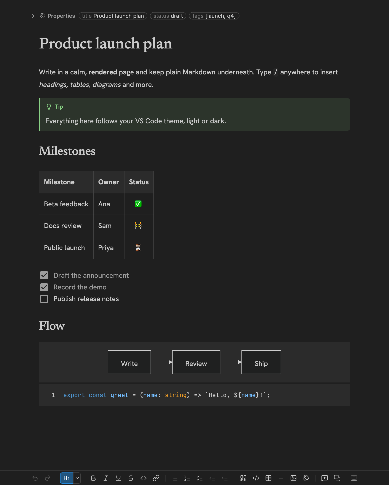
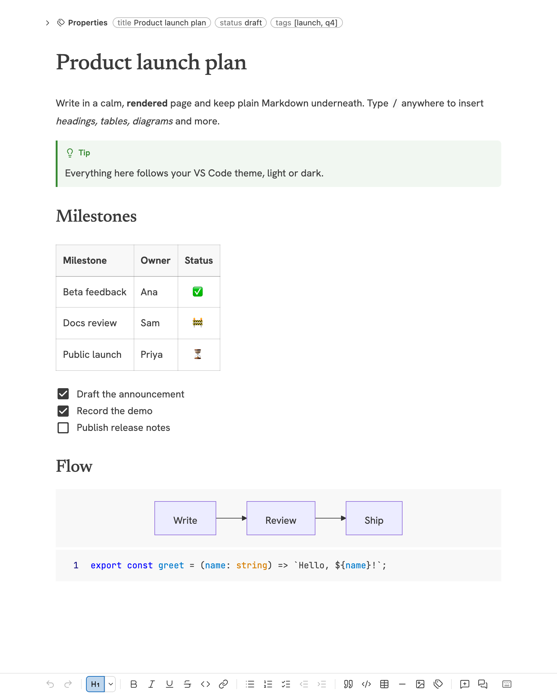

# Ken Markdown Editor

**Write Markdown the way it will look.** A calm, distraction-free WYSIWYG editor for every `.md` file in VS Code: no split preview, no syntax to squint at. Your VS Code theme colours everything, and your files stay plain, GitHub-compatible Markdown.





## Why you'll like it

- **Opens straight into the editor.** Every `.md` / `.markdown` file is edited in place. There is no preview pane to keep in sync. Need the raw text? One click opens the source.
- **Your files stay clean.** Saved as plain Markdown that GitHub, Git diffs and every other tool read as usual. Opening a file never rewrites it, and edits change only the lines you touched.
- **Native to VS Code.** Save, auto-save, undo, dirty markers, hot exit, Git and search all behave as they do for any text file.
- **Looks right in any theme.** Text, code, tables, alerts, menus and diagrams follow your colour theme and update live when you switch.
- **Fast to write.** Type `/` for a menu of everything you can insert, or use the keyboard shortcuts and the compact toolbar.

## Get started

1. Install **Ken Markdown Editor** from the Extensions view (<kbd>⇧⌘X</kbd> / <kbd>Ctrl+Shift+X</kbd>), or run:

   ```sh
   code --install-extension ArthurPachachura.ken-markdown-editor
   ```

2. Open any Markdown file. It opens in the editor.
3. Type `/` to insert headings, lists, tables, code blocks, diagrams, alerts and more. Press <kbd>⌘/</kbd> (<kbd>Ctrl+/</kbd>) to see every shortcut.

To view or edit the raw text, use the **Open Markdown Source** button in the editor's title bar. To make the plain text editor the default instead, use *Reopen Editor With…* → *Configure default editor for '*.md'…*.

## Features

### GitHub-flavoured Markdown, rendered as you type

Everything in the [GFM spec](https://github.github.com/gfm/) plus GitHub's extensions renders and edits in place and is written back faithfully:

- Headings, emphasis, links, images, quotes, rules and hard breaks
- **Tables** with column alignment, drag-to-resize columns and a full table menu
- **Task lists** you can tick with a click, with drag handles to reorder them
- Strikethrough, autolinks, footnotes and nested lists that keep their numbering style (`1.`, `a.`, `i.`, `1)`)
- **Code blocks** with syntax highlighting
- **GitHub alerts**: `> [!NOTE]`, `[!TIP]`, `[!IMPORTANT]`, `[!WARNING]`, `[!CAUTION]`
- **LaTeX math**, rendered with KaTeX: inline `$e^{i\pi} + 1 = 0$` (or `$$…$$` within a line) and `$$` blocks or ```` ```math ```` fences, as GitHub writes them. Click a formula to edit its source with a live preview
- Underline (written as `<ins>`, which GitHub renders underlined) and sanitized inline or block HTML (`<kbd>`, `<sub>`, `<mark>`, centered images…); double-click any HTML to edit its source
- `[[Wiki links]]` and relative links that open the target file; `#anchor` links that scroll within the document; copy-link buttons on headings

Saving normalises some syntax without changing what GitHub shows (setext headings become `#` headings, `*`/`+` bullets become `-`, reference-style links are written inline). Math follows GitHub's rules: the opening `$` must be followed and the closing `$` preceded by a non-space, and the closing `$` must not be followed by a digit, so prices like `$5 and $10` stay text. A literal `$` is escaped (`\$`) only where it would otherwise start math.

### Slash menu and toolbar

Type `/` at the start of a line or after a space and a compact menu opens instantly: text and headings, lists and checklists, quote, code block, table, divider, image, diagrams, equations, table of contents and the five alerts. Keep typing to filter. Direct shortcuts such as `/h2 `, `/todo `, `/quote ` and `/toc ` work too.

A slim toolbar (bottom by default; move it to the top or hide it with `kenMarkdown.toolbar`) covers undo/redo, a heading control, bold, italic, underline, strikethrough, inline code, links, lists, quote, code block, table, divider and image. Buttons show the state at the caret, and hovering shows each name and shortcut.

Typing Markdown works as you'd expect: `# `, `- `, `1. `, `[ ] `, `> `, `` ``` ``, `---`, `**bold**`, `*italic*`, `~~strike~~`, `` `code` ``, `$x^2$` and `$$ ` (an equation block) convert as you type.


Type `@` and part of a file name to link to any file in the open workspace: pick it from the list and it's inserted as a link by its path relative to the document (nothing is copied). Excluded, git-ignored and `node_modules` files aren't offered.

### Tables

With the caret in a table the toolbar switches to table actions, and right-clicking a cell offers the same list: insert, move and delete rows and columns, align columns, toggle full width, remove or restore the header row, and add a total row (column sums, set apart). <kbd>Tab</kbd> moves between cells and adds a row from the last one. Drag a column's border to resize it; widths are saved in a comment that GitHub and other renderers hide.

Cells can hold several lines and lists: <kbd>Shift+Enter</kbd> (or <kbd>Alt+Enter</kbd>) starts a new line, and the list buttons and shortcuts work in a cell. They're saved as `<br>` and inline `<ul>`/`<ol>` HTML, which GitHub renders.

Paste a block of cells (from a table, Excel, Google Sheets, or CSV/TSV text) and it fills the cells from the caret onward, growing the table as needed; one value pasted over several selected cells goes into each. Spreadsheet or CSV data pasted outside a table becomes a new table. <kbd>⇧⌘V</kbd> (<kbd>Ctrl+Shift+V</kbd>) pastes plain text in the formatting at the caret.

### Images and diagrams up close

Click an image or a Mermaid diagram to open it over the page, fitted to the window. Pinch or scroll to zoom around the pointer (or press <kbd>+</kbd> / <kbd>−</kbd>, and <kbd>0</kbd> to fit again), drag to move around, and click the picture to switch between fitted and 100%. Close it with the × in the top right corner, <kbd>Esc</kbd>, or a click outside the picture.

In the document, images are centred and at most half as tall as your screen. Right-click one to cut or copy it, add or remove its caption, show the file in Finder (File Explorer on Windows) or VS Code's Explorer, or delete it.

### Diagrams

- **Mermaid** diagrams render live from ` ```mermaid ` fences, themed to match your editor. Click one to zoom.
- **draw.io** diagrams: insert with `/drawio`, then double-click to edit in diagrams.net's embedded editor. They are saved as `.drawio.svg` or `.drawio.png`, ordinary images that GitHub shows, with the diagram source embedded.
- **Lucidchart** and Lucidspark: put a Lucid link on a line of its own and a live preview appears under it, with **Edit** and **Open in Lucidchart** (both open your browser) and **Reload**. The preview reloads when you come back from editing. The file keeps the plain link, which GitHub shows as a link. A Lucid link inside a sentence, or in a table, stays an ordinary link.

#### Making a Lucid diagram preview

The editor can't sign you in to Lucid, so a preview only shows diagrams that anyone with the link may view. Do one of these in Lucid:

- **Activate the embed code**: in the document, **More › Embed › Activate Embed Code**, then paste the document's link on its own line. Without this, the preview shows Lucid's sign-in or "request access" screen, or stays blank.
- **Publish it as an image** (recommended for repositories): **More › Publish › Image**, then link the image to the document:

  ```markdown
  [](https://lucid.app/lucidchart/<document id>/edit)
  ```

  It shows here and on GitHub, and gets the same Edit and Open buttons.

Set `kenMarkdown.lucidchart.preview` to `onClick` to load each preview only when you ask, or `off` for plain links.

### Comments

Select any text, table or image and click **Add comment** (<kbd>⌥⌘M</kbd> / <kbd>Ctrl+Alt+M</kbd>). Comments are threads: reply, resolve, reopen or delete. They're stored as hidden HTML comments, so they travel with the file and stay invisible on GitHub:

```markdown
Revenue grew <!-- ken:comment c1 -->**12%**<!-- /ken:comment c1 --> in Q3.
```

### Properties (frontmatter)

YAML frontmatter shows as an editable **Properties** panel above your text. Collapse it to a one-line summary, expand it to edit values, add or remove rows, or switch to raw YAML. Only the lines you change are rewritten, so comments and formatting are kept.

### Paste and drop images and files

- Paste a screenshot or drop an image and it's saved to an `_Images` folder next to the document and linked with a relative path. Change the folder with `kenMarkdown.imageFolder`.
- Other files are copied next to the document and linked inline.
- Files already in the workspace (dragged from VS Code's Explorer, or pasted or dropped from your file manager) are linked where they are instead of copied. Set `kenMarkdown.workspaceFiles` to `copy` to copy them too.
- To drop files into the editor, hold <kbd>Shift</kbd> while dropping (a VS Code rule for all editors).

### Live collaboration (preview)

Edit a document together in real time, with no server or account: whoever starts the session hosts it from their own VS Code.

1. Run **Ken Markdown: Start Collaboration Session**. An invite (`ws://…/?token=…`) is copied to your clipboard.
2. Send it to your collaborators. They run **Ken Markdown: Join Collaboration Session…** and paste it.
3. Everyone opens the same file (by its path in the workspace). Edits merge as you type. Each person's caret and selection show in their colour with their name, and avatars in the top-right corner show who's there. Properties and comment threads are shared too.

How guests reach you:

- **Live Share**: start a Live Share session first and guests can join with the invite as is (the session's port is shared with them automatically).
- **Same network or VPN**: turn on `kenMarkdown.collaboration.allowNetwork`; the invite then uses your network address.
- **Same machine**: works as is.

Your own VS Code writes the file. One editor per copy of the file saves the shared text, so Live Share guests editing your files don't write them twice, and people in their own checkout keep their own copy up to date. <kbd>⌘Z</kbd> undoes only your own changes. **Ken Markdown: Leave Collaboration Session** (or the *Collaborating* status bar item) ends it, and everyone keeps editing on their own.

### Print

**Print** (the printer button in the toolbar or the editor's title bar, or the command palette) opens the document in your default browser exactly as the editor shows it, theme, fonts, diagrams, math and images included, and brings up the print dialog. Print it, or choose *Save as PDF*.

### See what changed

**Open Changes in Ken Markdown** (the compare icon in the editor's title bar, a Markdown file's context menu in Source Control, the title bar of a text diff, or the command palette) shows a file's changes since the last commit rendered, not as Markdown source: added blocks in green, removed ones in red, and the words that changed inside an edited block highlighted. Both versions are editable, with the usual toolbar and shortcuts: **Combined** is the current document with the removed blocks shown where they were; **Split** puts the two versions side by side, scrolled together, and you can edit either (a version from git is read-only). The highlights follow every edit, and edits made elsewhere show up too. **Combined**, **Split** and **Switch to Text** (VS Code's text diff of the source) sit at the end of the toolbar. Set the default with `kenMarkdown.diff.layout`.

To compare any two Markdown files, select both in the Explorer and choose **Compare in Ken Markdown**, or run it from the command palette and pick the second file. Diffs of Markdown files that VS Code opens (Source Control, **Compare Selected**, the Timeline) open here too, rendered; **Switch to Text** shows the source in VS Code's diff editor instead. To keep VS Code's text diffs, set `kenMarkdown.diff.openMarkdownDiffs` to `text`.

### Looks the way you want

Typography is set for long-form reading, with Hanken Grotesk, Newsreader and JetBrains Mono bundled. Every font, the text size, line height and column width are adjustable in settings.

## Keyboard shortcuts

Every editing action is a VS Code command, so you can change, remove or add keys in VS Code's **Keyboard Shortcuts** editor (search for `Ken Markdown`). They apply only while this editor has focus. A selection of the defaults:

| Action | macOS | Windows / Linux |
| --- | --- | --- |
| Bold / Italic / Underline | ⌘B / ⌘I / ⌘U | Ctrl+B / Ctrl+I / Ctrl+U |
| Inline code | ⌘E | Ctrl+E |
| Link | ⌘K | Ctrl+K |
| Heading 1–6, Text | ⌥⌘1–6, ⌥⌘0 | Ctrl+Alt+1–6, Ctrl+Alt+0 |
| Numbered / Bulleted list / Checklist | ⌥⌘7 / ⌥⌘8 / ⌥⌘9 | Ctrl+Alt+7 / 8 / 9 |
| Quote | ⇧⌘B | Ctrl+Shift+B |
| Code block | ⌥⌘C | Ctrl+Alt+C |
| Add comment | ⌥⌘M | Ctrl+Alt+M |
| Paste as plain text | ⇧⌘V | Ctrl+Shift+V |
| Clear formatting | ⌘\\ | Ctrl+\\ |
| Check / uncheck checklist item | ⌘Enter | Ctrl+Enter |
| Indent / outdent list item | ⌘] / ⌘[ (or Tab / ⇧Tab) | Ctrl+] / Ctrl+[ |
| Move table row, list item or block up / down | ⌥↑ / ⌥↓ | Alt+↑ / Alt+↓ |
| Duplicate table row, list item or block | ⇧⌥↓ / ⇧⌥↑ | Shift+Alt+↓ / ↑ |
| Insert table | ⌥⌘T | Ctrl+Alt+T |
| Table: insert row above / below | ⌃⌥↑ / ⌃⌥↓ | Ctrl+Alt+↑ / ↓ |
| Table: move column left / right | ⌃⌥← / ⌃⌥→ | Ctrl+Alt+← / → |
| Table: insert column left / right | ⌃⌥⇧← / ⌃⌥⇧→ | Ctrl+Alt+Shift+← / → |
| Table: delete row / column | ⌃⌥⌫ / ⌃⌥⇧⌫ | Ctrl+Alt+Backspace / Ctrl+Alt+Shift+Backspace |
| Show all shortcuts | ⌘/ | Ctrl+/ |

## Settings

| Setting | Default | Description |
| --- | --- | --- |
| `kenMarkdown.fontSize` | `16` | Base font size in px; headings, code and lists scale from it. |
| `kenMarkdown.bodyFontFamily` | Hanken Grotesk | Body text font stack. |
| `kenMarkdown.headingFontFamily` | Newsreader | Heading font stack. |
| `kenMarkdown.quoteFontFamily` | *(heading font)* | Block quote font stack (set in italics). |
| `kenMarkdown.codeFontFamily` | JetBrains Mono | Inline code and code block font stack. |
| `kenMarkdown.lineHeight` | `1.85` | Body line height. |
| `kenMarkdown.paragraphSpacing` | `0.65` | Space between paragraphs, in em (multiples of the font size). Doesn't change list item spacing. |
| `kenMarkdown.headingSpacingBefore` | `2.25` | Space above headings, in em, for a body-size heading; larger headings get up to 1.35× (H1). After a paragraph it replaces the paragraph spacing rather than adding to it. The first heading doesn't move. |
| `kenMarkdown.headingSpacingAfter` | `0.55` | Space below headings, in em of each heading's own size. |
| `kenMarkdown.maxWidth` | `720` | Width of the text column in px. |
| `kenMarkdown.diff.layout` | `combined` | How **Open Changes in Ken Markdown** shows changes: `combined` (one column) or `split` (side by side). |
| `kenMarkdown.diff.openMarkdownDiffs` | `ken` | Where diffs of two Markdown files open: rendered in the Ken Markdown diff view (`ken`) or in VS Code's text diff editor (`text`). |
| `kenMarkdown.headingNumbers.enabled` | `false` | Show a grey number inline before each heading's text (`1`, `1.a`, `Section 1.01`…) and before each table of contents entry. Display only: it can't be selected, edited or copied, and is never written to the file. Headings inside quotes, alerts, lists and tables aren't numbered; a skipped level (H2 then H4) is left out, not shown as 0. |
| `kenMarkdown.headingNumbers.preset` | `custom` | `outline` (1, 1.a, 1.a.i…), `decimal` (1, 1.1, 1.1.1…), `legal` (1.1.1, then (a), (i), (A)), `legal-full` (1.1.1, then 1.1.1(a), 1.1.1(a)(i), 1.1.1(a)(i)(A)), `legal-article` (Article I, Section 1.01, (a), (i), (A), (1)), `legal-article-full` (Article I, Section 1.01, then 1.01(a), 1.01(a)(i), 1.01(a)(i)(A), 1.01(a)(i)(A)(1)), or `custom` for the per-level settings below. A preset other than `custom` overrides them. |
| `kenMarkdown.headingNumbers.h1` … `h6` | `decimal`, `lower-alpha`, `lower-roman`, `decimal`, `lower-alpha`, `lower-roman` | Style per level: `decimal` (1), `decimal-leading-zero` (01), `lower-alpha` (a), `upper-alpha` (A), `lower-roman` (i), `upper-roman` (I), parenthesized `parenthesized-decimal` (1) … `parenthesized-upper-roman` (I), right-paren `decimal-paren` 1) … `upper-roman-paren` I), or `none` (not numbered, and left out of deeper headings' numbers). |
| `kenMarkdown.headingNumbers.h1Parents` … `h6Parents` | `auto` | `full`: parent numbers, then this level's (`1.a.i`; no separator before a parenthesized part: `1.01(a)`). `legal`: the same path with plain letter and roman parents (a, A, i, I) as digits, as Word's legal style (`Section 1.01` under `Article I`); other parents keep their style (`1.01(a)(i)`). `own`: only this level's label (`(a)`). `auto`: `own` for parenthesized styles, `full` otherwise. |
| `kenMarkdown.headingNumbers.h1Prefix` … `h6Prefix` | *(empty)* | Text before that level's own label, such as `Article ` or `Section `; not repeated in deeper labels. |
| `kenMarkdown.headingNumbers.separator` | `.` | Text between the parts of a number. |
| `kenMarkdown.toolbar` | `bottom` | `bottom`, `top` or `hidden`. |
| `kenMarkdown.alwaysShowProperties` | `false` | Show the Properties panel on every document. |
| `kenMarkdown.commentAuthor` | *(git's `user.name`)* | Your name on comments you add. |
| `kenMarkdown.imageFolder` | `_Images` | Where pasted and dropped images are saved; empty for beside the document. |
| `kenMarkdown.lucidchart.preview` | `auto` | Lucidchart/Lucidspark link previews: `auto` loads each from lucid.app when it scrolls into view, `onClick` waits for a Load preview click, `off` shows plain links. |
| `kenMarkdown.workspaceFiles` | `link` | Files already in the workspace: `link` to them where they are, or `copy` them like outside files. |
| `kenMarkdown.collaboration.port` | `0` | Port for collaboration sessions you start; `0` picks a free one. |
| `kenMarkdown.collaboration.allowNetwork` | `false` | Let people on your network join sessions you start (invites still need their secret token). |

A document can override the `kenMarkdown.headingNumbers.*` settings with a `ken-heading-numbering` property in its frontmatter: `off`; `on` (your settings); a preset name (`outline`, `decimal`, `legal`, `legal-full`, `legal-article`, `legal-article-full`); or a format string with one token per level from H1 down and the same separator between them. Set it with the gear in the expanded Properties panel, or right-click a heading and choose **Heading numbering…** (the same menu has **Copy link to heading**). The dialog writes the shortest form that fits.

| Format token | Meaning |
| --- | --- |
| `1` `a` `A` `i` `I` | decimal, lower/upper letters, lower/upper roman |
| `01` | decimal with a leading zero (Section 1.01) |
| `(1)` `(a)` `(A)` `(i)` `(I)` | parenthesized |
| `1)` `a)` `A)` `i)` `I)` | right paren |
| `_` | not numbered |
| `[text]` before a token | prefix for that level, e.g. `[Article ]I` |
| `+` `#` `!` after a token | parents: `+` full, `#` legal (letter and roman parents as digits), `!` own; none given is auto |

Examples: `"1.a.i"`, `"I-1-a"`, `"1.1.1.(a).(i).(A)"` (the `legal` preset), `"[Article ]I.[Section ]01#.(a).(i).(A).(1)"` (the `legal-article` preset), `"[Article ]I.[Section ]01#.(a)#.(i)#.(A)#.(1)#"` (the `legal-article-full` preset). The separator can't contain `0 1 a A i I _ ( ) [ ] + # !`; a one-token format takes its separator from your settings, and levels a format leaves out use your settings.

## FAQ

**Will it change my Markdown files?** Only when you edit them, and only the changed lines are rewritten. Opening a file never modifies it.

**Does it need an internet connection?** No. The exceptions are editing draw.io diagrams, which loads diagrams.net's embedded editor (nothing is uploaded), and Lucidchart previews, which load from lucid.app (Lucid sees the document id and your IP address; nothing from the file is sent). Without a connection a Lucid preview says you're offline and loads once you're back. Set `kenMarkdown.lucidchart.preview` to `onClick` or `off` to load nothing from Lucid until you ask.

**Is live collaboration secure?** The session runs only while you host it, and only people with the invite's secret token can join. By default it listens on your machine only. Traffic isn't encrypted on a network, so prefer Live Share or a VPN outside trusted networks. Concurrent edits to the same Property or the same comment thread keep the last one saved.

**Does it work with other VS Code builds?** It works in VS Code 1.90 and newer, and in compatible forks that support custom editors.

## Feedback

Found a bug or have an idea? Please [open an issue](https://github.com/smo-key/md-editor-vscode/issues). To work on the extension itself, see [CONTRIBUTING.md](CONTRIBUTING.md).
