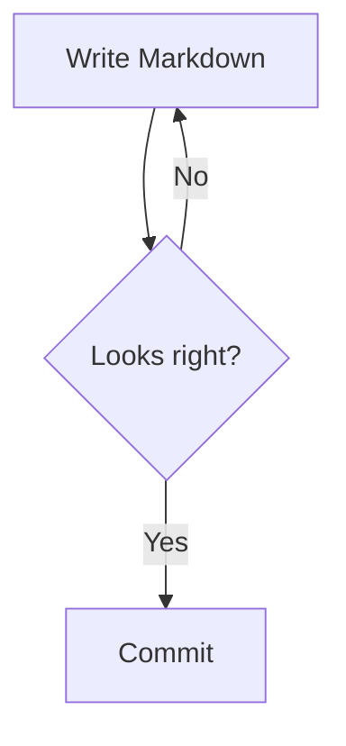
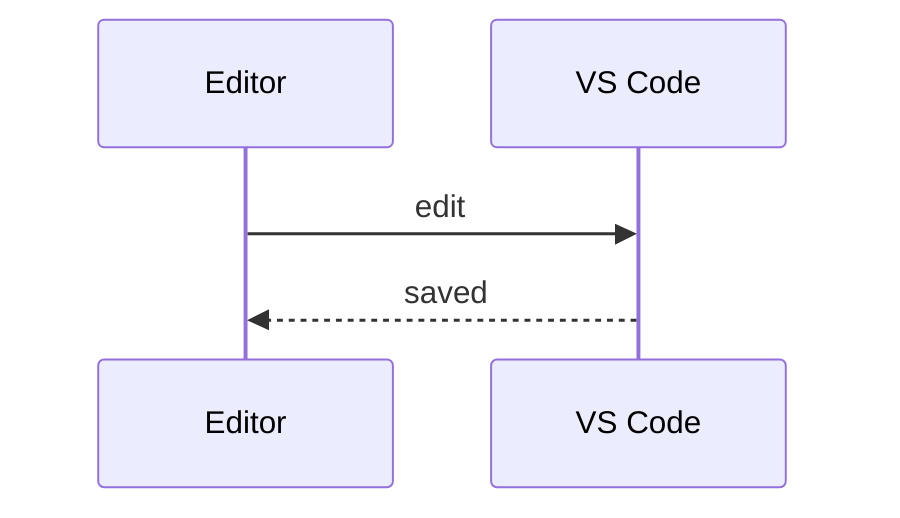
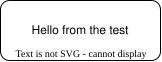

# Ken Markdown feature tour

Every feature of the editor in one file, written the way the editor saves it. Open it in the Ken Markdown Editor; the raw file shows what GitHub would render.

<!-- ken:toc -->
- [Text formatting](#text-formatting)
- [Links](#links)
- [Headings](#headings)
  - [Heading 3](#heading-3)
    - [Heading 4](#heading-4)
      - [Heading 5](#heading-5)
        - [Heading 6](#heading-6)
- [Lists](#lists)
- [Quotes and alerts](#quotes-and-alerts)
- [Code](#code)
- [Math](#math)
- [Tables](#tables)
- [Images and diagrams](#images-and-diagrams)
- [Comments](#comments)
- [HTML and footnotes](#html-and-footnotes)

## Text formatting

Plain text, **bold**, *italic*, ***bold italic***, ~~strikethrough~~, <ins>underline</ins> and `inline code`. A run of *emphasis around a [link](https://example.com) and `code`* stays one span.

A hard line break ends this line\
and continues here. A tab in a paragraph	stays a tab.

---

## Links

- A web link: [Milkdown](https://milkdown.dev "Milkdown's site")
- A bare URL (an autolink literal): https://github.com
- An autolink: <https://code.visualstudio.com>
- An email: me@example.com
- A link to another file in the project: [sample.md](sample.md)
- A link to a heading in this document: [Tables](#tables)
- A link to a heading in another file: [nested doc](docs/nested.md)
- A wiki link: [[sample]]
- A Lucidchart link alone on its line shows a preview:

https://lucid.app/lucidchart/3f2a1b4c-1111-4222-8333-444455556666/edit

## Headings

### Heading 3

#### Heading 4

##### Heading 5

###### Heading 6

## Lists

- Bulleted item
- Another item
  - Nested item
    - Deeper item
- Back to the top level

1. Numbered item
2. Second step
   1. Sub-step
   2. Another sub-step
3. Third step

1) Numbered with a parenthesis
2) Second

- [ ] An open task
- [x] A finished task
  - [ ] A nested task

- A loose list item with two paragraphs.

  Its second paragraph.

- Another loose item.

## Quotes and alerts

> A block quote, set in the heading serif, in italics.
>
> > A nested quote.

> [!NOTE]
> Useful information that users should know, even when skimming.

> [!TIP]
> Helpful advice for doing things better or more easily.

> [!IMPORTANT]
> Key information users need to know to achieve their goal.

> [!WARNING]
> Urgent info that needs immediate user attention to avoid problems.

> [!CAUTION]
> Advises about risks or negative outcomes of certain actions.

## Code

```ts
// Syntax highlighted, themed to match VS Code.
export function greet(name: string): string {
  return `Hello, ${name}!`;
}
```

```
A fence with no language.
```





## Math

Inline math such as $E = mc^2$ and $\sqrt{a^2 + b^2}$, while prices like $5 and $10 stay text.

$$
\int_0^\infty e^{-x^2}\,dx = \frac{\sqrt{\pi}}{2}
$$

## Tables

| Left | Center | Right |
| :--- | :----: | ----: |
| a    |   b    |     1 |
| c    |   d    |    22 |

<!-- ken:table full widths=160,,120 -->
| Item | Notes | Cost |
| - | - | -: |
| Apples | line one<br>line two | $3.00 |
| Pears | <ul><li>ripe</li><li>[x] washed</li></ul> | $4.50 |
| Plums | **bold**, *italic*, `code` and a [link](https://example.com) | $2.25 |

<!-- ken:table total -->
| Quarter | Revenue |
| - | -: |
| Q1 | $1,200 |
| Q2 | $1,450 |
| Total | $2,650 |

<!-- ken:table noheader -->
|   |   |
| - | - |
| A table | without a header row |
| Second | row |

## Images and diagrams


A draw.io diagram (double-click to edit):



An inline image  inside a sentence.

## Comments

This sentence has a <!-- ken:comment c1 -->commented phrase<!-- /ken:comment c1 --> that opens a thread.

## HTML and footnotes

<details>
<summary>Raw HTML renders, sanitized</summary>

Press <kbd>Ctrl</kbd>+<kbd>S</kbd> to save. H<sub>2</sub>O and x<sup>2</sup>.

</details>

A sentence with a footnote.[^1]

[^1]: The footnote's text.

<!-- ken:comments
{"c1":{"resolved":false,"messages":[{"id":"m1","author":"Ana","date":"2026-10-20T10:00:00.000Z","text":"Is this phrase clear?"},{"id":"m2","author":"Bo","date":"2026-10-20T11:00:00.000Z","text":"Yes, keep it."}]}}
-->
